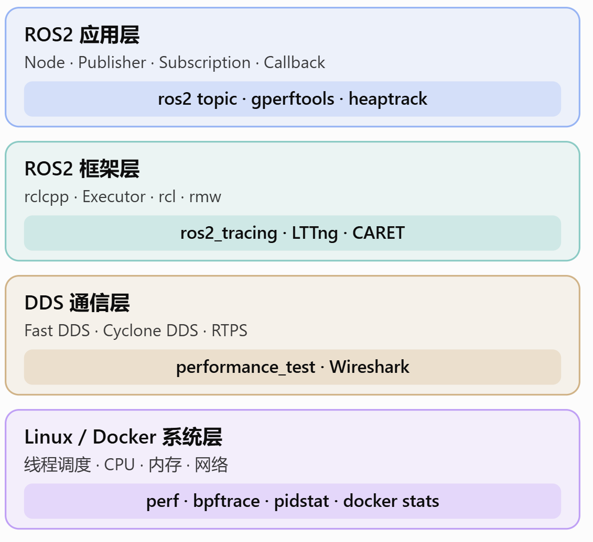
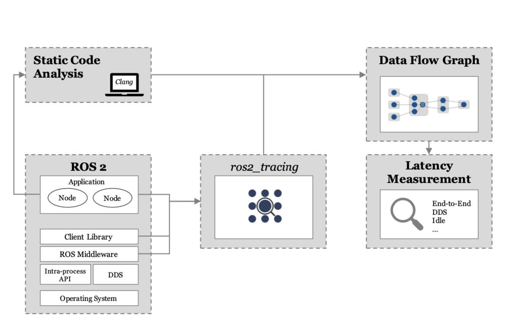

<!--
 * @Author: JohnJeep
 * @Date: 2026-11-07 11:33:02
 * @LastEditors: JohnJeep
 * @LastEditTime: 2026-11-07 17:32:14
 * @Description: optimizing the performance of robotics systems
 * Copyright (c) 2026 by John Jeep, All Rights Reserved.
-->

# 1. Robotics Performance Optimization

对机器人系统中的性能优化是一个关键的研究领域，涉及多个方面，包括硬件设计、软件算法、控制策略以及系统集成。本文将探讨如何通过不同的方法和技术来提升机器人系统的整体性能。

可以从以下几个方面来优化机器人系统的性能：
- ROS2 框架性能
- Linux 系统性能
- DDS 通信性能
- 内存性能

对 ROS2 C++ 开发者，建议重点掌握以下几个工具的使用：
- ros2_tracing：分析 ROS2 内部的执行流程、Callback 延迟、Executor 调度。
- perf：分析 CPU 性能瓶颈、线程调度和函数热点。
- gperftools：分析 C++ 函数 CPU 消耗和堆内存分配。
- heaptrack：分析内存申请、释放、分配热点。
- performance_test：测试 ROS2/DDS 的消息延迟与吞吐量。

性能分析全景，从整体到局部的思想。




常用工具详细对比

| 工具                   | 解决的问题                                      | 推荐程度 |
| ---------------------- | ----------------------------------------------- | -------- |
| ros2_tracing / LTTng   | Callback 执行时间、Executor 调度、ROS2 内部事件 | ★★★★★    |
| perf                   | CPU 热点、调用栈、调度行为                      | ★★★★★    |
| gperftools             | C/C++ CPU 和堆内存分析                          | ★★★★☆    |
| heaptrack              | 内存分配热点、潜在泄漏                          | ★★★★★    |
| CARET                  | 多节点消息链路、端到端延迟分析                  | ★★★★☆    |
| performance_test       | DDS/ROS2 延迟、吞吐量对比                       | ★★★★★    |
| ros2 topic hz/bw       | Topic 发布频率、接收吞吐量                      | ★★★★★    |
| Valgrind / ASan        | 内存越界、非法访问、泄漏                        | ★★★★☆    |
| Wireshark              | RTPS/DDS 网络报文分析                           | ★★★★☆    |
| bpftrace / eBPF        | 内核事件、调度、系统调用、网络问题              | ★★★★☆    |
| docker stats / pidstat | CPU、内存、线程资源监控                         | ★★★★★    |

这里的星级是按日常 ROS2 C++ 开发的实用性给出的主观建议，而不是工具性能排名。


# 2. ROS2_tracing

ROS2 tracing 是 ROS2 官方提供的性能分析工具，基于 LTTng（Linux Trace Toolkit Next Generation）实现。它可以帮助开发者深入了解 ROS2 系统内部的执行流程，包括 Callback 的执行时间、Executor 的调度行为以及节点间的通信延迟等。

下面是 ROS2 tracing 的一个示意图，展示了如何通过 tracing 工具来分析 ROS2 系统的性能瓶颈。




有下面几个部分组成：
- tracetools：用于启动和管理跟踪会话的命令行工具。
- tracetools_launch：用于在 ROS2 launch 文件中集成跟踪功能的工具。
- tracetools_read：用于读取和解析跟踪数据的工具。
- tracetools_analysis：用于分析和可视化跟踪数据的工具。
- tracetools_test：用于测试和验证跟踪功能的工具。
- tracetools_tracepoints：用于在 ROS2 代码中插入 tracepoints 的工具。
- ros2trace：用于启动和管理 ROS2 tracing 的命令行工具。


## 2.1. 如何使用

以 ROS2 Jazzy 为例，检查 Tracepoint 支持：
```bash
source /opt/ros/jazzy/setup.bash

ros2 run tracetools status
```

安装跟踪工具。若尚未安装：
```bash
sudo apt install ros-jazzy-tracetools  ros-jazzy-ros2trace
```

启动 Trace 会话：
```bash
ros2 trace
```
随后在另一个终端启动目标 ROS2 节点，复现性能问题，最后结束跟踪。

对于需要多次启停的实验，也可以使用具名会话：
```bash
ros2 trace start my_session

# 在另一个终端运行 ROS2 程序

ros2 trace stop my_session
```
采集到的数据可以借助 tracetools_analysis 或 Trace Compass 等工具进行分析。某些复杂的 Executor 等待时间分析还需要结合额外 Tracepoint 或内核调度事件，而不能只依靠默认事件。


# 3. References
- [ROS2 Tracing](https://github.com/ros2/ros2_tracing)
